# 🔐 Infraestructura 2 — VPN de Acceso Remoto con Jump Server (RDS RemoteApp) y FortiGate

**Matrícula 20252241** · Práctica 3

[](#-parámetros-usados) [](#-parámetros-usados) [](#-jump-server-rds-y-remoteapp) [](#-parámetros-usados) [](#-parámetros-usados)

> Un firewall FortiGate (configurado por GUI) publica una VPN IPsec de acceso remoto que **únicamente** da acceso a un Jump Server Windows con RDS RemoteApp. Desde el Jump Server, los usuarios solo llegan al Web Server por HTTPS, RDP y SSH, y cada usuario ve solamente las aplicaciones que le corresponden según su perfil.

---

## 📺 Video de Demostración

> **[Ver demostración en YouTube →](PEGAR_AQUI_EL_ENLACE_DEL_VIDEO)**

---

## 📑 Tabla de Contenido

1. [Objetivo de la Red](#-objetivo-de-la-red)
2. [Cumplimiento de Requisitos](#-cumplimiento-de-requisitos)
3. [Direccionamiento IP basado en la matrícula (VLSM)](#-direccionamiento-ip-basado-en-la-matrícula-vlsm)
4. [Parámetros Usados](#-parámetros-usados)
5. [Documentación de la Red](#-documentación-de-la-red)
6. [Funcionamiento de la Configuración](#-funcionamiento-de-la-configuración)
7. [Configuración de la VPN](#-configuración-de-la-vpn)
8. [Jump Server: RDS y RemoteApp](#-jump-server-rds-y-remoteapp)
9. [Validación de la Implementación](#-validación-de-la-implementación)
10. [Scripts de Prueba](#-scripts-de-prueba)
11. [Estructura del Repositorio](#-estructura-del-repositorio)

---

## 🎯 Objetivo de la Red

Demostrar un acceso controlado y por capas a los servidores:

- **VPN de acceso remoto:** el cliente remoto solo puede llegar al **Jump Server**, y únicamente por HTTPS y RDP. No tiene acceso directo al Web Server.
- **Jump Server → Web Server:** el Jump Server solo puede alcanzar los servicios **HTTPS, RDP y SSH** del Web Server. Cualquier otro puerto está bloqueado.
- **Usuarios de la VLAN 10:** llegan al Jump Server por HTTPS (RD Web y cliente web). El usuario **sin privilegios** tiene el SSH hacia los servidores bloqueado con políticas explícitas.
- **Perfiles dentro del Jump Server:** el usuario sin privilegios solo tiene publicado el navegador (Web); el usuario con privilegios tiene publicados Web, PuTTY y Conexión a Escritorio remoto.

---

## ✅ Cumplimiento de Requisitos

| Requisito | Implementado con |
| --- | --- |
| FortiGate configurado por GUI | Interfaces, DHCP, rutas, objetos, políticas, usuarios y VPN configurados desde la interfaz web de FortiOS |
| Configuraciones de red (FortiGate) | WAN hacia el ISP, subinterfaz VLAN 10, interfaz de acceso remoto, una LAN por servidor y rutas estáticas |
| VPN Remote-Site entre Cliente y Servidor | VPN IPsec de acceso remoto `vpn-remote-2241` (plantilla *Dialup - FortiClient*), con un cliente Linux (strongSwan) |
| La VPN solo da acceso al Jump Server | Política de la VPN con destino `JUMP-SERVER` (HTTPS y RDP) y grupo de redes del túnel que solo contiene al Jump Server |
| El Jump Server solo accede a HTTPS, RDP y SSH del Web Server | Política `JUMP-to-WEB` entre `LAN-JUMP (port5)` y `LAN-WEB (port4)`; el resto cae en el *Implicit Deny* |
| Equipo de red (Cisco) | Router `router-cisco` y switches Cisco IOSvL2 con VLAN 10 y trunk |
| ISP con IPs públicas | Router `isp` con enlaces públicos `22.41.3.0/30` y `22.41.4.0/30`, y salida a internet con NAT |
| 2 servidores en /29, cada uno en su propia LAN | Web Server en `10.22.41.128/29` (port4) y Jump Server en `10.22.41.136/29` (port5) |
| Web Server: Sistema de Caja | Servidor Ubuntu con Apache (HTTPS), OpenSSH y RDP (xrdp) |
| Jump Server con RDP RemoteApp y RemoteApp Web Client | Windows Server 2022 con Remote Desktop Services, colección de sesión y RD Web Client |
| 2 usuarios en /25, VLAN 10, DHCP | Dos máquinas Ubuntu en `10.22.41.0/25`, con IP por DHCP reservada por MAC |
| Usuario sin privilegios: solo Web, con SSH bloqueado | Grupo `GRP-SinPrivilegios` con solo Microsoft Edge publicado, y políticas `DENY-SSH-SINPRIV-*` |
| Usuario con privilegios: Web, PuTTY y RDP | Grupo `GRP-ConPrivilegios` con Edge, PuTTY y Conexión a Escritorio remoto publicados |
| Direccionamiento basado en la matrícula | Redes derivadas de los dígitos `22` y `41` de la matrícula y subdivididas con VLSM |

---

## 🧮 Direccionamiento IP basado en la matrícula (VLSM)

### 1. Origen de las direcciones

Mi matrícula es **2025-2241** (`20252241`). Tomé sus **últimos cuatro dígitos, `2241`**, y los separé en dos pares, **`22`** y **`41`**, que son los que aparecen en las redes del laboratorio:

| Dígitos de la matrícula | Dónde se usan | Ejemplo |
| --- | --- | --- |
| `22` → segundo octeto | Redes LAN privadas (usuarios y servidores) | 10.**22**.41.0 |
| `41` → tercer octeto | Redes LAN privadas (usuarios y servidores) | 10.22.**41**.0 |
| `22.41` → dos primeros octetos | Enlaces "públicos" entre el ISP y los equipos | **22.41**.3.0/30 |

### 2. Bloque base y requisitos

El bloque base de las redes internas es **`10.22.41.0/24`** (254 hosts). La tarea exige:

- Una red de **usuarios de tipo /25**.
- **Dos servidores de tipo /29**, cada uno en su propia LAN.
- Enlaces con IPs públicas entre el ISP y los equipos (punto a punto).

### 3. Subdivisión con VLSM

Se aplicó **VLSM (Variable Length Subnet Mask)**: se asigna primero la subred más grande y después las más pequeñas, usando un prefijo distinto para cada segmento según los hosts que necesita. Así no se desperdician direcciones y las subredes no se solapan.

| # | Segmento | Prefijo | Máscara | Hosts útiles | Red | Rango utilizable | Broadcast |
| --- | --- | --- | --- | --- | --- | --- | --- |
| 1 | Usuarios (VLAN 10) | /25 | 255.255.255.128 | 126 | 10.22.41.0 | 10.22.41.1 – 10.22.41.126 | 10.22.41.127 |
| 2 | LAN Web Server | /29 | 255.255.255.248 | 6 | 10.22.41.128 | 10.22.41.129 – 10.22.41.134 | 10.22.41.135 |
| 3 | LAN Jump Server | /29 | 255.255.255.248 | 6 | 10.22.41.136 | 10.22.41.137 – 10.22.41.142 | 10.22.41.143 |
| 4 | Enlace ISP ↔ FortiGate | /30 | 255.255.255.252 | 2 | 22.41.3.0 | 22.41.3.1 – 22.41.3.2 | 22.41.3.3 |
| 5 | Enlace ISP ↔ Router Cisco | /30 | 255.255.255.252 | 2 | 22.41.4.0 | 22.41.4.1 – 22.41.4.2 | 22.41.4.3 |

**Cálculo de cada prefijo:**

- **/25:** 32 − 25 = 7 bits de host → 2⁷ = 128 direcciones → 126 hosts útiles. Bloque `10.22.41.0 – 10.22.41.127`.
- **/29:** 32 − 29 = 3 bits de host → 2³ = 8 direcciones → 6 hosts útiles. El Web Server ocupa `10.22.41.128 – 10.22.41.135` y el Jump Server `10.22.41.136 – 10.22.41.143`, uno a continuación del otro y a continuación de la red de usuarios.
- **/30:** 32 − 30 = 2 bits de host → 2² = 4 direcciones → 2 hosts útiles, los justos para un enlace punto a punto.

El resto del bloque `10.22.41.0/24` (`10.22.41.144 – 10.22.41.255`) queda libre para crecimiento futuro.

### 4. Otras redes de la solución

| Red | Uso |
| --- | --- |
| `10.212.135.10 – 10.212.135.20` | Rango de direcciones virtuales que el FortiGate asigna a los clientes de la VPN |
| `192.168.237.0/24` | Red de acceso remoto del laboratorio: el cliente VPN (`192.168.237.3`) alcanza al FortiGate en `192.168.237.2` (port3) |
| VMnet2 (solo anfitrión, sin DHCP) | Enlace del Jump Server (máquina virtual de VMware) hacia GNS3 mediante un nodo Cloud conectado a `port5` |
| Dominio `lab2241.local` | Dominio de Active Directory creado en el Jump Server para Remote Desktop Services |

### 5. Asignación de direcciones

| Dispositivo | Interfaz | IP | Subred |
| --- | --- | --- | --- |
| FortiGate | `user-valn10` (VLAN 10, sobre port2) | 10.22.41.1 | 10.22.41.0/25 |
| usuario-priv-2241 | ens3 (DHCP, reserva por MAC) | 10.22.41.20 | 10.22.41.0/25 |
| usuario-sinpriv-2241 | ens3 (DHCP, reserva por MAC) | 10.22.41.21 | 10.22.41.0/25 |
| FortiGate | `LAN-WEB` (port4) | 10.22.41.129 | 10.22.41.128/29 |
| Web Server | ens3 | 10.22.41.130 | 10.22.41.128/29 |
| FortiGate | `LAN-JUMP` (port5) | 10.22.41.137 | 10.22.41.136/29 |
| Jump Server | Adaptador conectado a VMnet2 | 10.22.41.138 | 10.22.41.136/29 |
| FortiGate | `WAN-ISP` (port1) | 22.41.3.2 | 22.41.3.0/30 |
| ISP | FastEthernet1/0 | 22.41.3.1 | 22.41.3.0/30 |
| ISP | FastEthernet1/1 | 22.41.4.1 | 22.41.4.0/30 |
| Router Cisco | FastEthernet1/0 | 22.41.4.2 | 22.41.4.0/30 |
| FortiGate | port3 (acceso remoto) | 192.168.237.2 | 192.168.237.0/24 |
| Cliente VPN | ens3 | 192.168.237.3 | 192.168.237.0/24 |

**Evidencia en los equipos:**

Interfaces, rutas y NAT del router ISP:

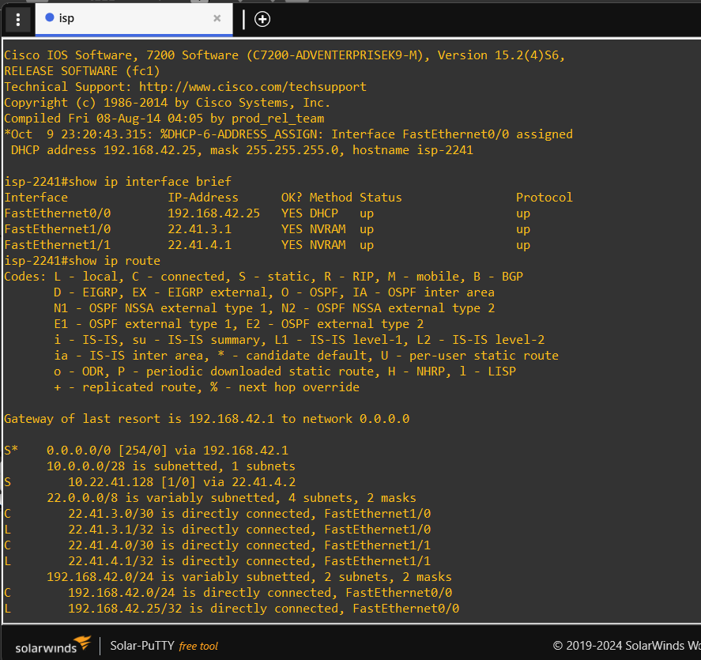

Interfaces y rutas del router Cisco:

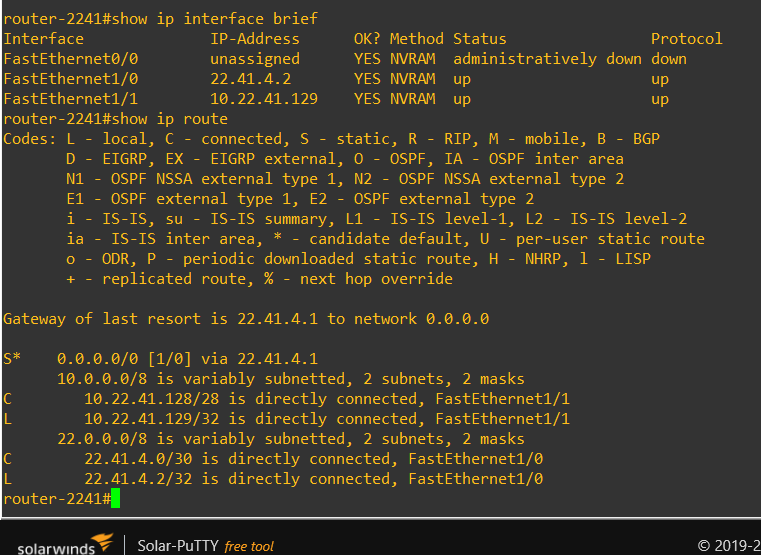

Interfaces del FortiGate (`WAN-ISP`, `LAN-WEB`, `LAN-JUMP`, subinterfaz VLAN 10 y port3):

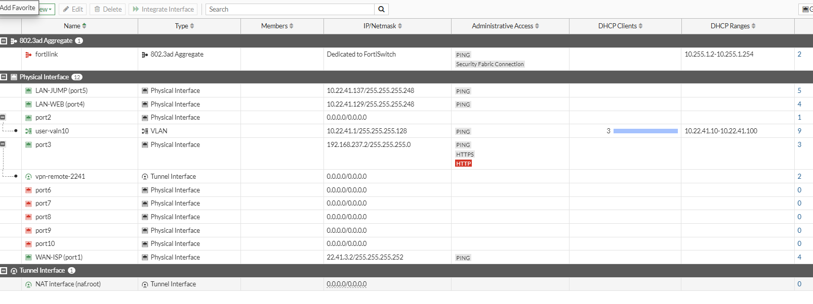

Servidor DHCP de la VLAN 10 (`10.22.41.10 – 10.22.41.100`) y reservas por MAC de los dos usuarios:

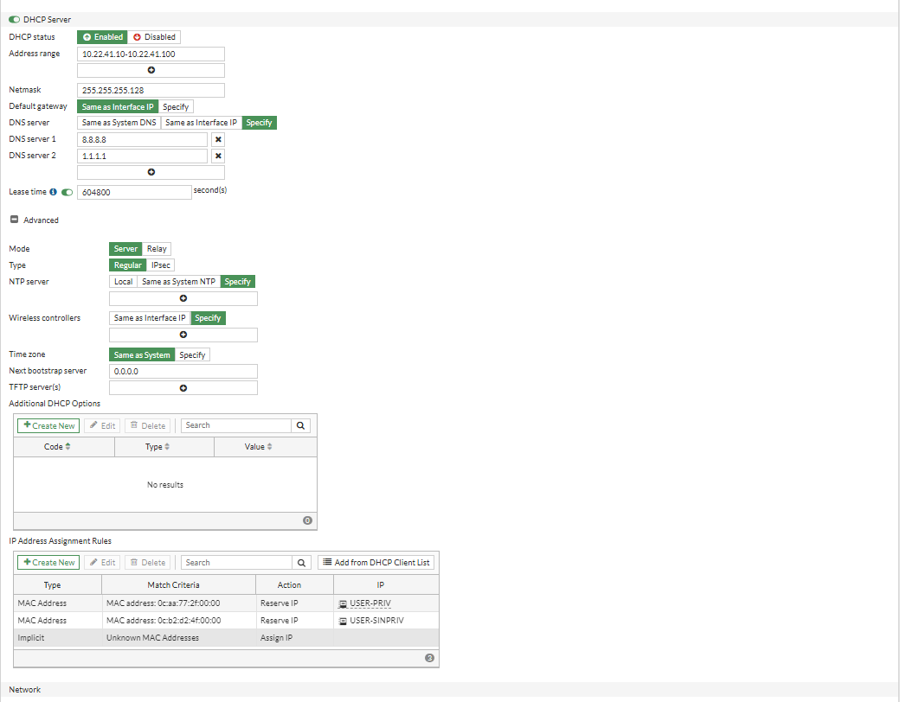

---

## 🧩 Parámetros Usados

| Parámetro | Valor |
| --- | --- |
| Plataforma FortiGate | FortiGate-VM64-KVM, FortiOS 7.0.9 |
| Equipo de red | Router Cisco (`router-cisco`) |
| ISP | Router Cisco (`isp`), con NAT hacia internet |
| Switches | Cisco IOSvL2: `switch-2241-1` (usuarios) y `switch-2241-2` (cliente VPN) |
| Emulador | GNS3 (con GNS3 VM) |
| Red de usuarios (VLAN 10) | `10.22.41.0/25`: gateway `10.22.41.1`, DHCP `10.22.41.10 – 10.22.41.100` |
| Red del Web Server | `10.22.41.128/29`: gateway `10.22.41.129`, servidor `10.22.41.130` |
| Red del Jump Server | `10.22.41.136/29`: gateway `10.22.41.137`, servidor `10.22.41.138` |
| Enlaces públicos | `22.41.3.0/30` (ISP ↔ FortiGate) y `22.41.4.0/30` (ISP ↔ Router Cisco) |
| Túnel VPN | `vpn-remote-2241` (plantilla *Dialup - FortiClient*, enlazado a port3) |
| Cliente VPN | Ubuntu con strongSwan, conexión `VPN-REMOTE-2241` |
| Usuario VPN | `vpn2241` (autenticación XAuth) |
| Web Server | Ubuntu con Apache (HTTPS), OpenSSH y xrdp con XFCE |
| Jump Server | Windows Server 2022 Standard Evaluation, dominio `lab2241.local`, alias DNS `jump.lab2241.local` |
| Usuarios de la VLAN 10 | Dos máquinas Ubuntu: `usuario-priv-2241` y `usuario-sinpriv-2241` |

---

## 🌐 Documentación de la Red

### Topología

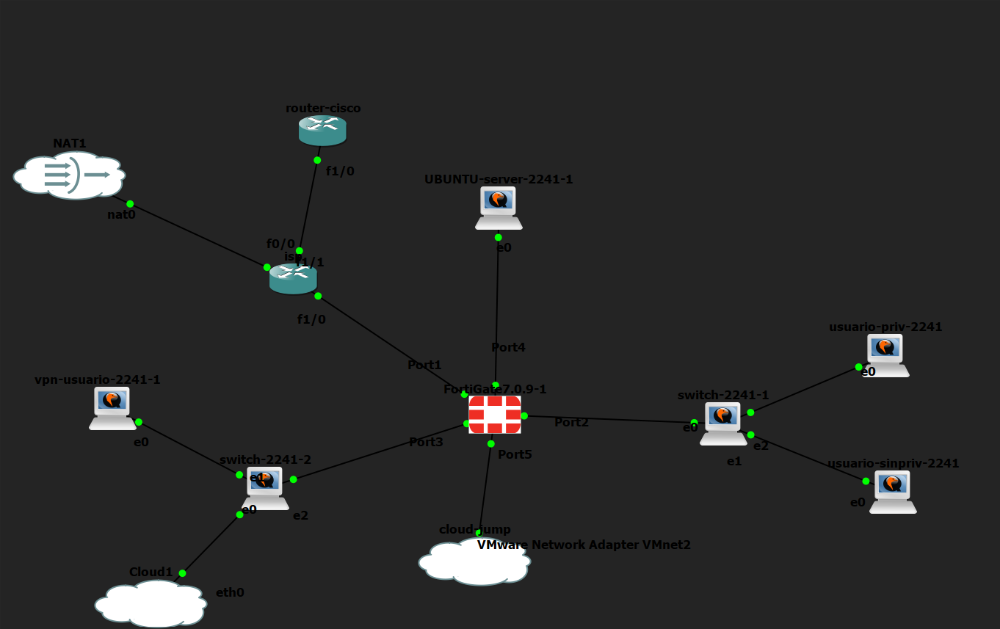

### Diagrama de acceso

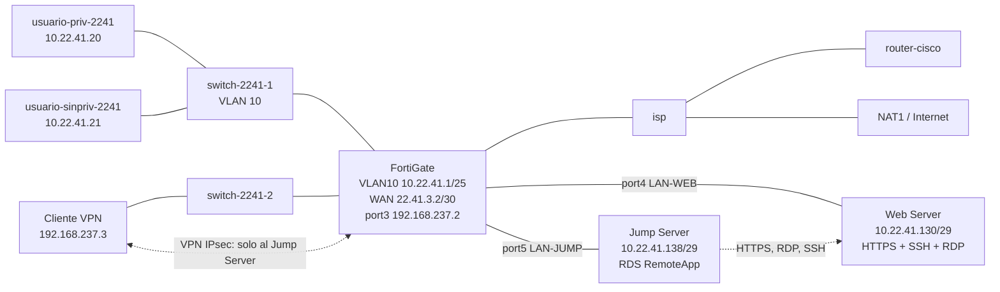

### Switches y VLAN 10

VLAN 10 en el switch de los usuarios, con los dos puertos de usuario asignados:

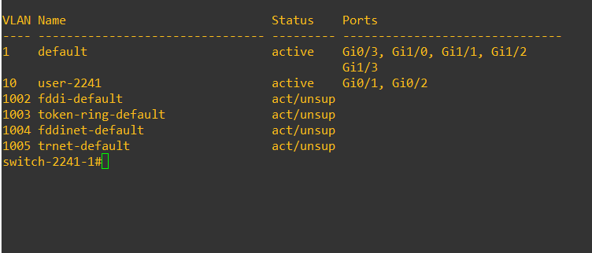

Enlace trunk de los usuarios hacia el FortiGate:

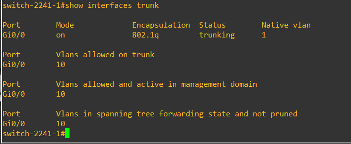

Switch del cliente VPN:

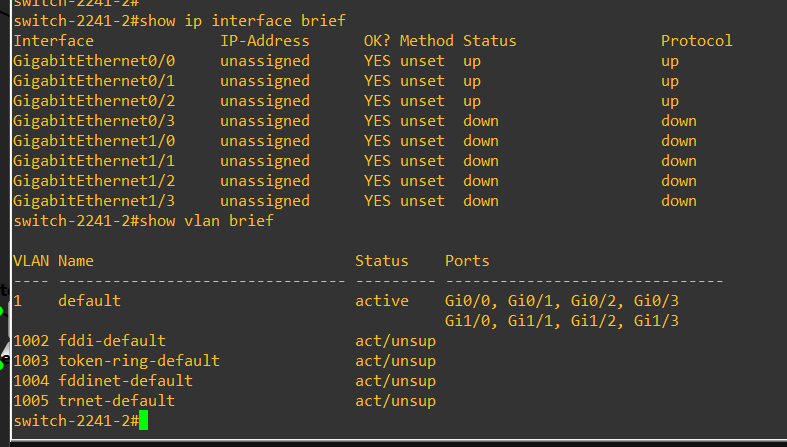

### FortiGate

Rutas estáticas:

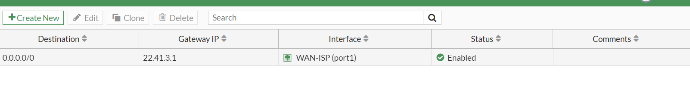

Objetos de dirección (servidores, usuarios y grupo de redes de la VPN):

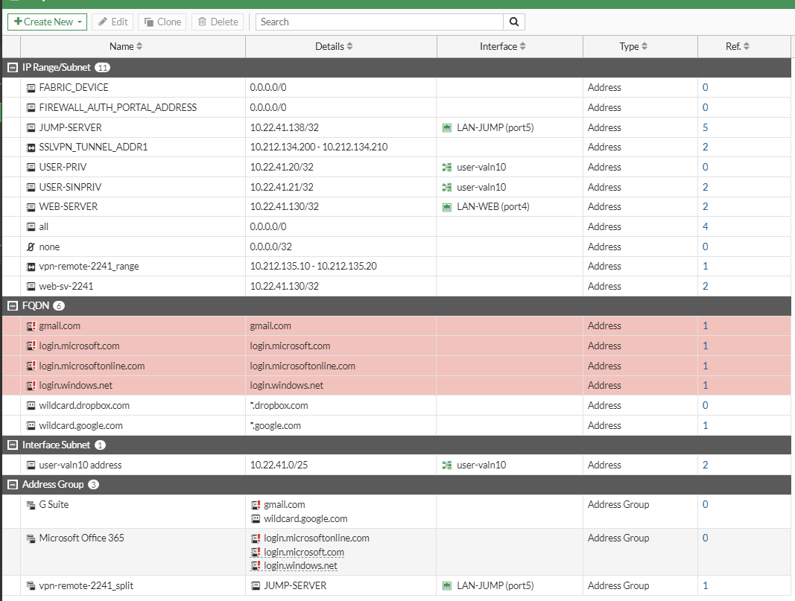

Políticas de firewall:

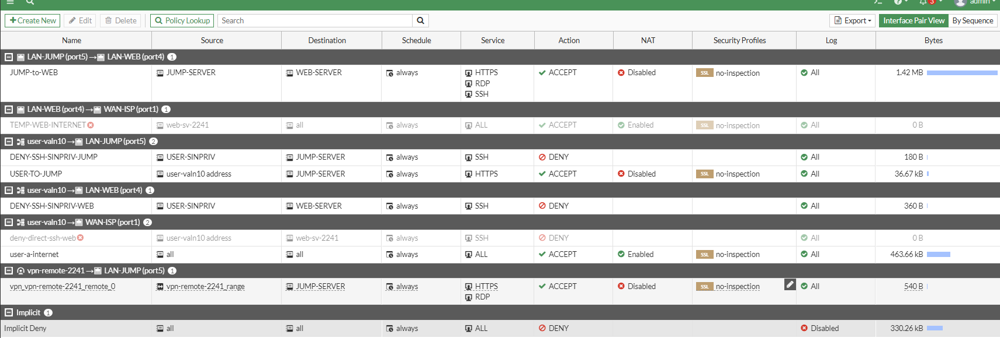

### Web Server

Servicios activos del Web Server (HTTPS, SSH y RDP):

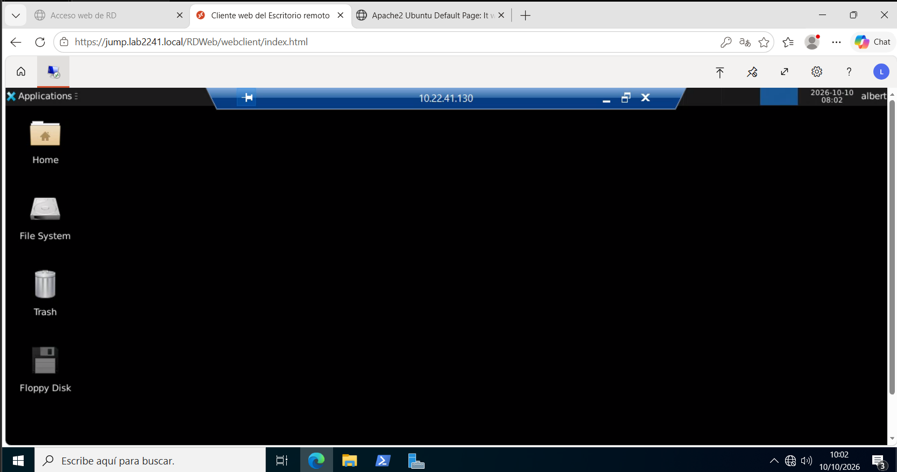

### Jump Server

Red del Jump Server (dirección, puerta de enlace y rutas de retorno hacia los usuarios y la VPN):

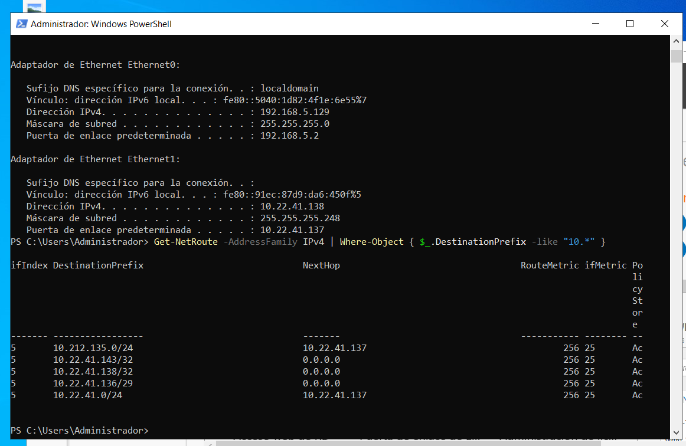

Dominio de Active Directory, usuarios y grupos:

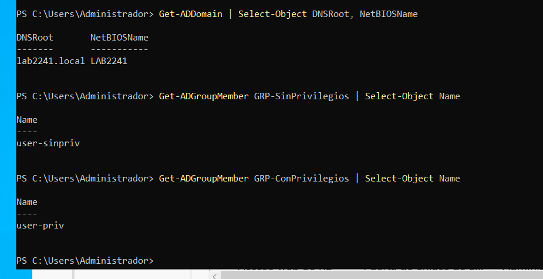

---

## 🔬 Funcionamiento de la Configuración

**Segmentación:** el switch entrega la VLAN 10 a los usuarios y la une por trunk al FortiGate, que termina la VLAN como subinterfaz 802.1Q sobre `port2` y entrega direcciones por DHCP. Cada servidor tiene su propia LAN conectada a una interfaz distinta del FortiGate (`port4` para el Web Server y `port5` para el Jump Server), de modo que **todo el tráfico entre ellos pasa por el firewall**. El cliente VPN se conecta al FortiGate por `port3`, a través de un segundo switch.

**Políticas de firewall activas:**

| Política | Origen | Destino | Servicio | Acción |
| --- | --- | --- | --- | --- |
| `vpn_vpn-remote-2241_remote_0` | Rango de la VPN (`vpn-remote-2241_range`), entra por el túnel | `JUMP-SERVER` (sale por `LAN-JUMP`) | HTTPS, RDP | ACCEPT, sin NAT |
| `JUMP-to-WEB` | `JUMP-SERVER` (`LAN-JUMP`) | `WEB-SERVER` (`LAN-WEB`) | HTTPS, RDP, SSH | ACCEPT, sin NAT |
| `USER-TO-JUMP` | Red de usuarios (`user-valn10`) | `JUMP-SERVER` (`LAN-JUMP`) | HTTPS | ACCEPT, sin NAT |
| `DENY-SSH-SINPRIV-JUMP` | `USER-SINPRIV` (10.22.41.21) | `JUMP-SERVER` | SSH | DENY |
| `DENY-SSH-SINPRIV-WEB` | `USER-SINPRIV` (10.22.41.21) | `WEB-SERVER` | SSH | DENY |
| `user-a-internet` | Red de usuarios | all (por `WAN-ISP`) | ALL | ACCEPT, con NAT |
| Implicit Deny | all | all | ALL | DENY |

Las políticas `TEMP-WEB-INTERNET` (usada solo para instalar xrdp en el Web Server) y `deny-direct-ssh-web` (heredada de la Infraestructura 3) quedaron **deshabilitadas**.

- La política de la VPN solo permite llegar al Jump Server, y solo por HTTPS y RDP. El grupo de redes del túnel (`vpn-remote-2241_split`) contiene únicamente al Jump Server.
- `JUMP-to-WEB` es la que limita al Jump Server a HTTPS, RDP y SSH hacia el Web Server. Cualquier otro puerto (por ejemplo HTTP 80) se bloquea.
- Los usuarios de la VLAN 10 solo tienen permitido el HTTPS hacia el Jump Server. Al Web Server no llegan directamente: lo hacen a través del Jump Server.
- Al usuario sin privilegios (`10.22.41.21`) se le bloquea el SSH hacia ambos servidores con políticas **explícitas**, que además registran el intento en los logs.
- Todo lo que no coincide con una política cae en el *Implicit Deny*.

**Perfiles de los usuarios:** la diferencia entre los dos perfiles se aplica en dos niveles. En la red, por IP de origen (políticas `DENY-SSH-SINPRIV-*`). En el Jump Server, por grupo de Active Directory, que decide qué RemoteApp ve cada cuenta.

Políticas específicas de los dos usuarios:

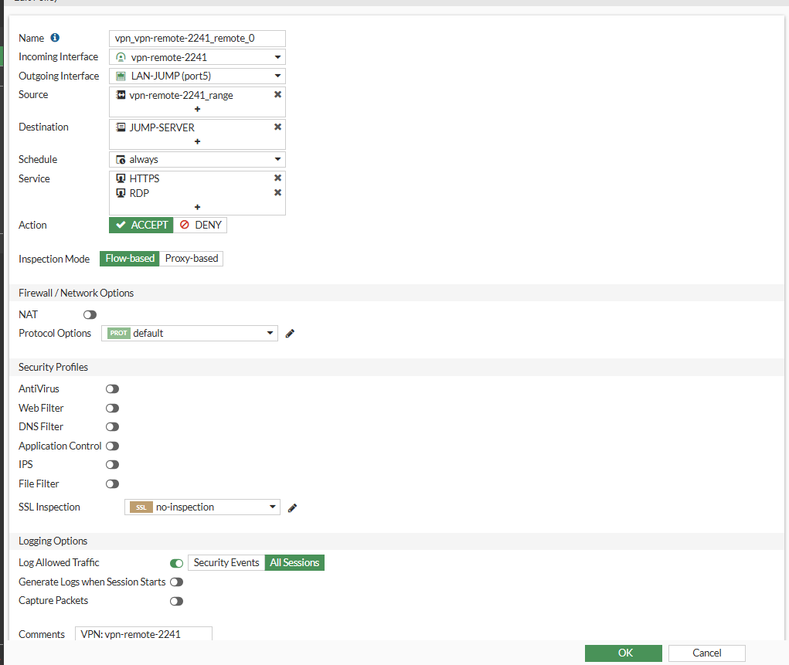

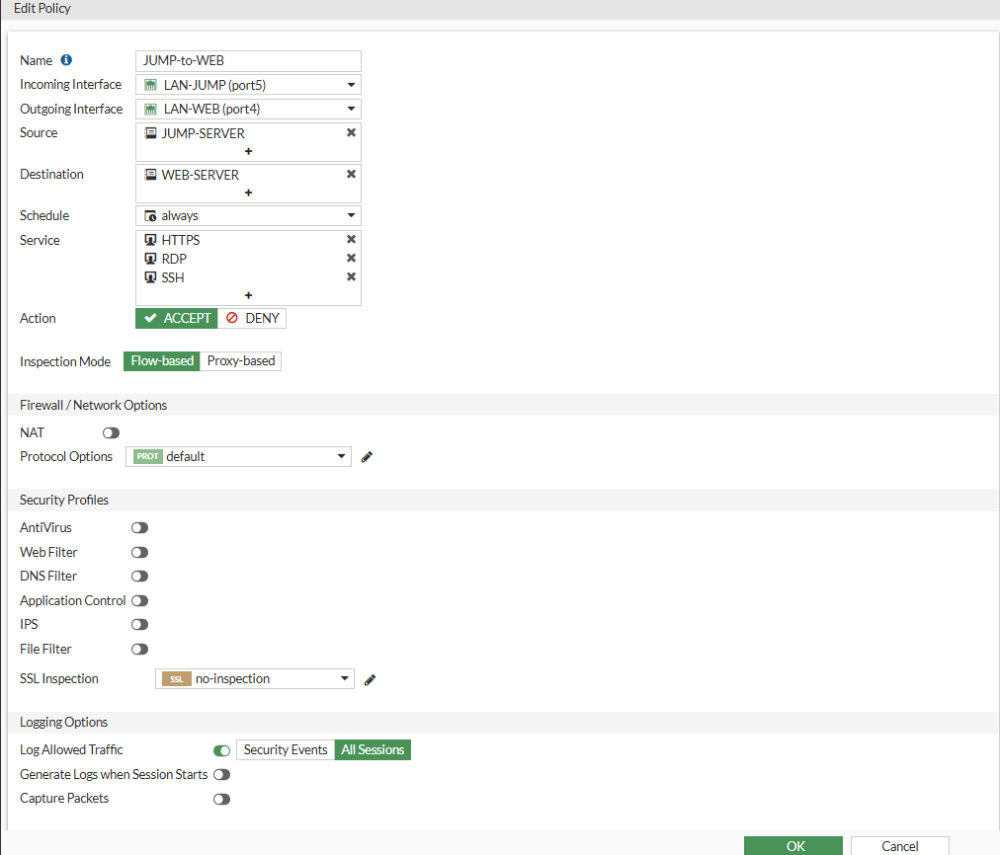

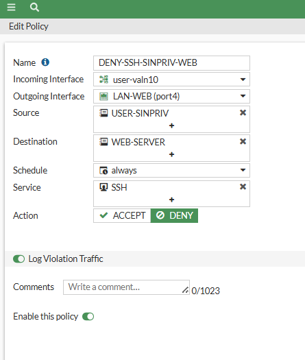

---

## 🔧 Configuración de la VPN

> La VPN se configuró desde la GUI de FortiOS (**VPN → IPsec Wizard**, plantilla *Dialup - FortiClient*). El cliente es un Ubuntu con strongSwan.

| Parámetro | Valor |
| --- | --- |
| Tipo | IPsec de acceso remoto (dial-up) |
| Interfaz del FortiGate | port3 (`192.168.237.2`) |
| Versión IKE | IKEv1, modo Aggressive |
| Autenticación | Clave precompartida + XAuth (usuario `vpn2241`) |
| Fase 1 | DES, SHA1, grupo Diffie-Hellman 5 (MODP 1536) |
| Fase 2 | ESP con DES y SHA1, PFS con grupo 5 |
| IP virtual del cliente | `10.212.135.10` |
| Tráfico protegido | `10.212.135.10/32` ↔ `10.22.41.138/32` (**solo el Jump Server**) |

Configuración de la VPN en el FortiGate:

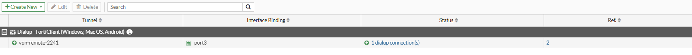

Grupo de usuarios de la VPN:

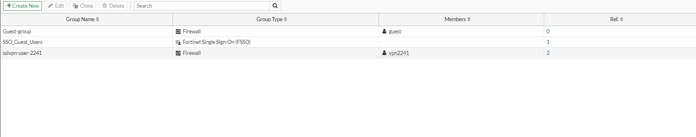

Usuario de la VPN:

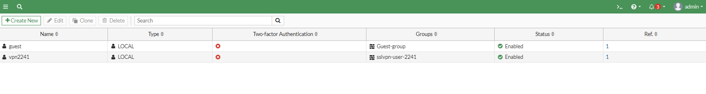

> La clave precompartida y las contraseñas de los usuarios no se incluyen en este repositorio.

---

## 🪟 Jump Server: RDS y RemoteApp

El Jump Server es el único punto de entrada hacia el Web Server. Es un **Windows Server 2022** con Remote Desktop Services, que publica aplicaciones (RemoteApp) accesibles desde el navegador mediante el **RD Web Client**.

| Componente | Detalle |
| --- | --- |
| Sistema operativo | Windows Server 2022 Standard Evaluation (Desktop Experience) |
| Dominio | `lab2241.local` (NetBIOS `LAB2241`), con DNS integrado |
| Implementación RDS | Basada en sesión (Agente de conexión, Host de sesión, Acceso web y Puerta de enlace) |
| Colección | `QuickSessionCollection` |
| Acceso web (RD Web) | `https://jump.lab2241.local/RDWeb` |
| Cliente web HTML5 | `https://jump.lab2241.local/RDWeb/webclient/index.html` |
| Certificado | Autofirmado, válido para `jump.lab2241.local` |
| Conectividad | Un adaptador en la LAN del Jump (`10.22.41.138`, gateway `10.22.41.137`) y otro hacia internet, usado solo para instalar componentes |

**Usuarios y grupos:**

| Usuario | Grupo | Programas RemoteApp publicados |
| --- | --- | --- |
| `user-sinpriv` | `GRP-SinPrivilegios` | Microsoft Edge (Web) |
| `user-priv` | `GRP-ConPrivilegios` | Microsoft Edge (Web), PuTTY y Conexión a Escritorio remoto (RDP) |

La colección solo acepta a los dos grupos, y cada programa RemoteApp está asignado al grupo que corresponde. PuTTY y Conexión a Escritorio remoto solo están asignados a `GRP-ConPrivilegios`.

Servicios de Escritorio remoto instalados:

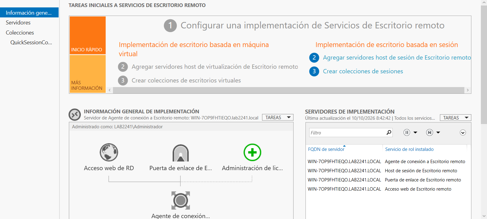

Colección y grupos con acceso:

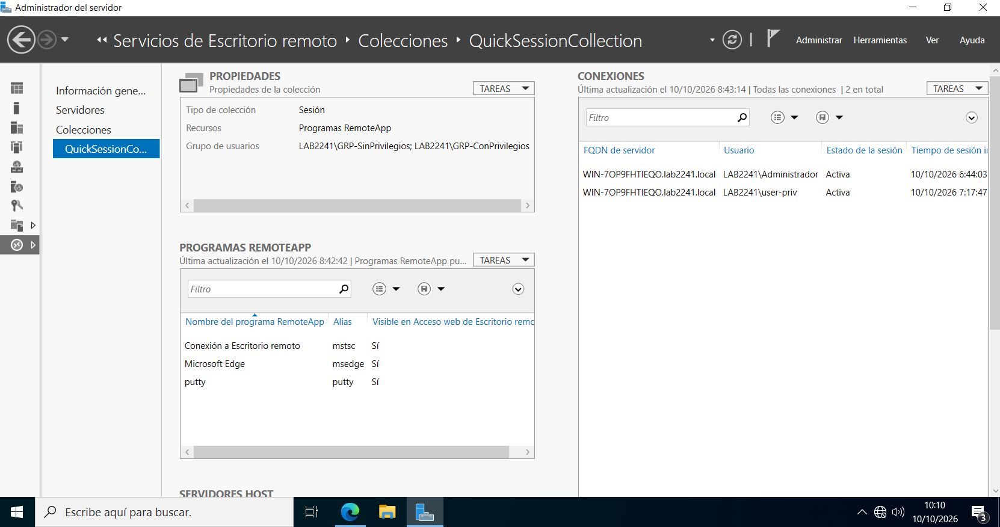

Programas RemoteApp publicados:

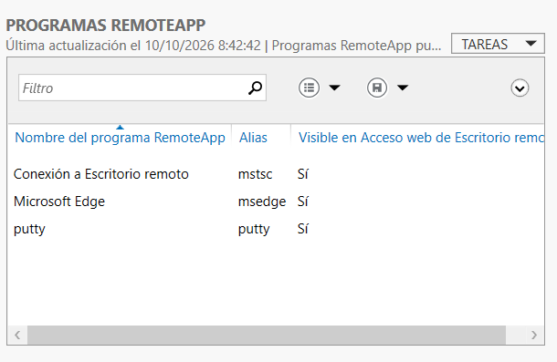

Asignación de PuTTY únicamente al grupo con privilegios:

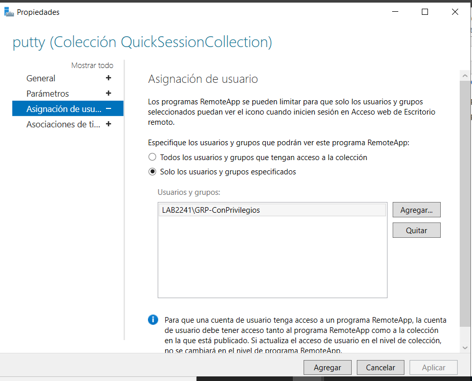

---

## 🧪 Validación de la Implementación

**Prueba 1 — La VPN solo llega al Jump Server:** desde el cliente VPN se levanta la conexión (`connection 'VPN-REMOTE-2241' established successfully`) y se prueban los puertos con `nc -zv -w 3`:

| Destino | Puerto | Resultado |
| --- | --- | --- |
| Jump Server `10.22.41.138` | 443 (HTTPS) | `succeeded` |
| Jump Server `10.22.41.138` | 3389 (RDP) | `succeeded` |
| Jump Server `10.22.41.138` | 22 (SSH) | `timed out` |
| Web Server `10.22.41.130` | 443 (HTTPS) | `timed out` |

La VPN da acceso al Jump Server solo por HTTPS y RDP, y no permite llegar al Web Server.

Conexión de la VPN establecida y selectores de tráfico del túnel:

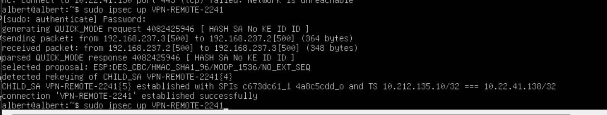

Pruebas de puertos a través de la VPN:

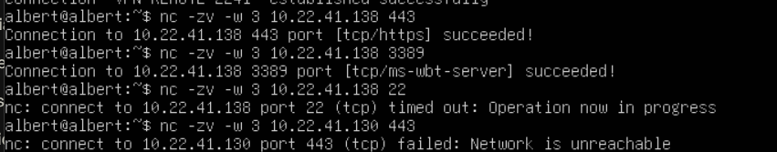

**Prueba 2 — El Jump Server solo llega a HTTPS, RDP y SSH del Web Server:** con `Test-NetConnection` desde PowerShell en el Jump Server, los puertos 443, 22 y 3389 responden `True`, y el puerto 80 responde `False`:

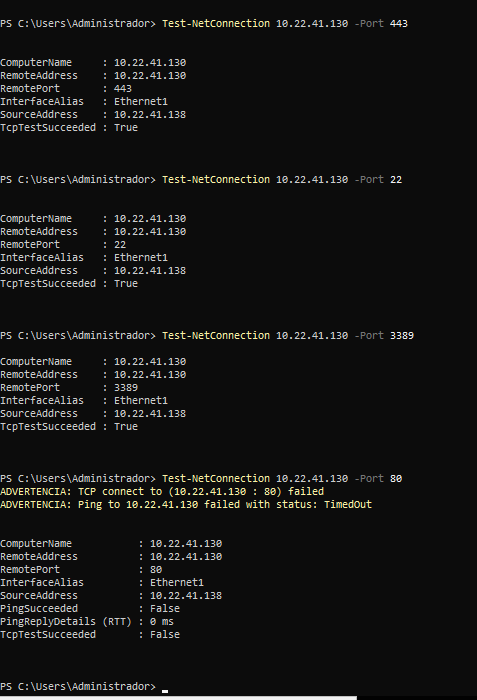

**Prueba 3 — Usuarios de la VLAN 10:** cada usuario recibe su IP por DHCP (`.20` y `.21`), llega al Jump Server por HTTPS (`succeeded`) y no puede llegar al Web Server por SSH (`timed out`):

Usuario con privilegios (`usuario-priv-2241`):

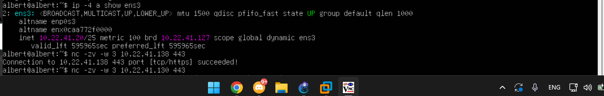

Usuario sin privilegios (`usuario-sinpriv-2241`):

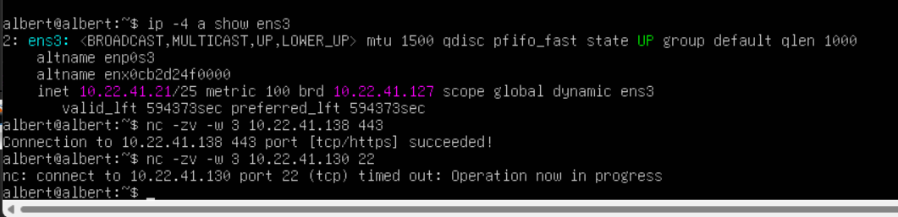

**Prueba 4 — Bloqueo explícito del SSH al usuario sin privilegios:** en **Log & Report → Forward Traffic**, filtrando por el origen `10.22.41.21`, los intentos de SSH aparecen con acción **Deny**, asociados a las políticas `DENY-SSH-SINPRIV-JUMP` y `DENY-SSH-SINPRIV-WEB`:


**Prueba 5 — Aplicaciones publicadas por perfil (RD Web Client):**

El usuario `user-priv` ve Microsoft Edge, PuTTY y Conexión a Escritorio remoto:

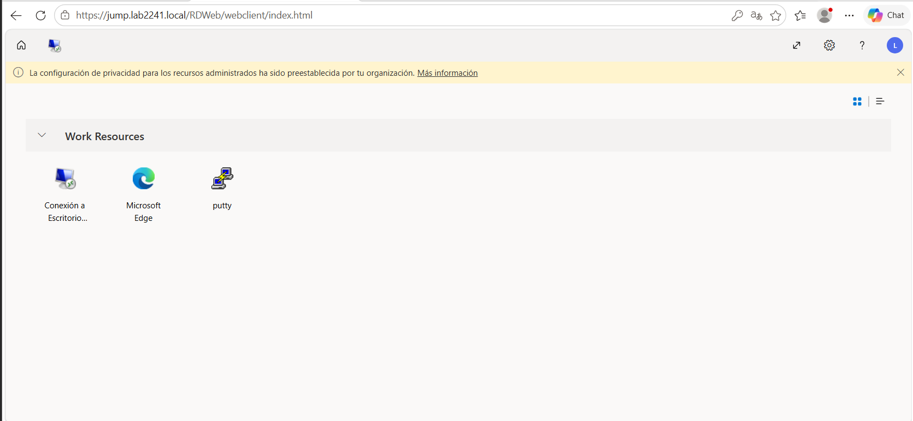

El usuario `user-sinpriv` ve únicamente Microsoft Edge:

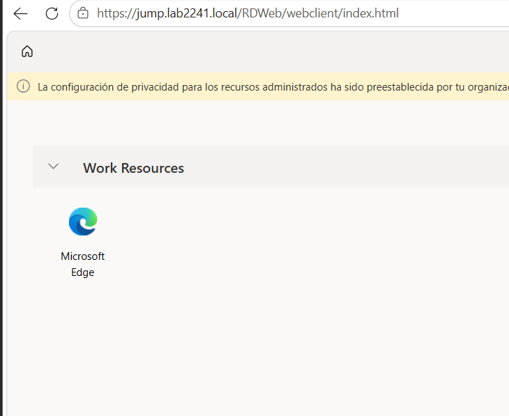

**Prueba 6 — Servicios del Web Server desde el Jump Server:** con el usuario con privilegios, las tres aplicaciones publicadas llegan al Web Server.

SSH con PuTTY (`10.22.41.130`):

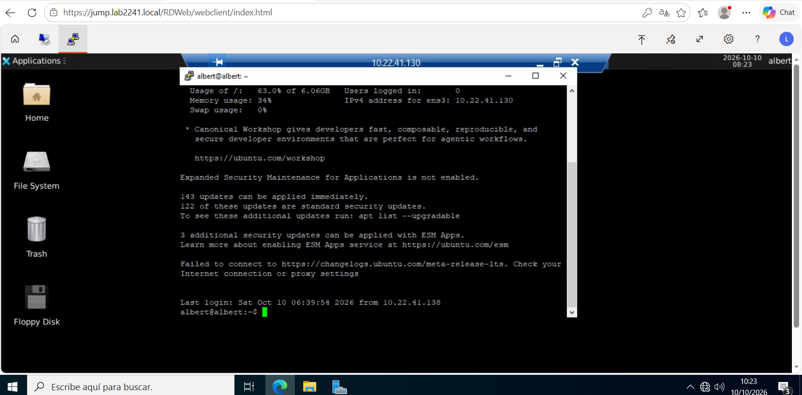

RDP con Conexión a Escritorio remoto (`10.22.41.130`):

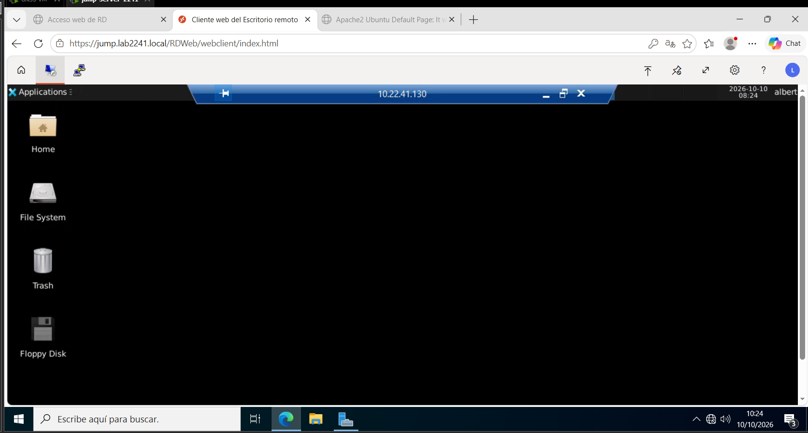

HTTPS con Microsoft Edge (`https://10.22.41.130`):

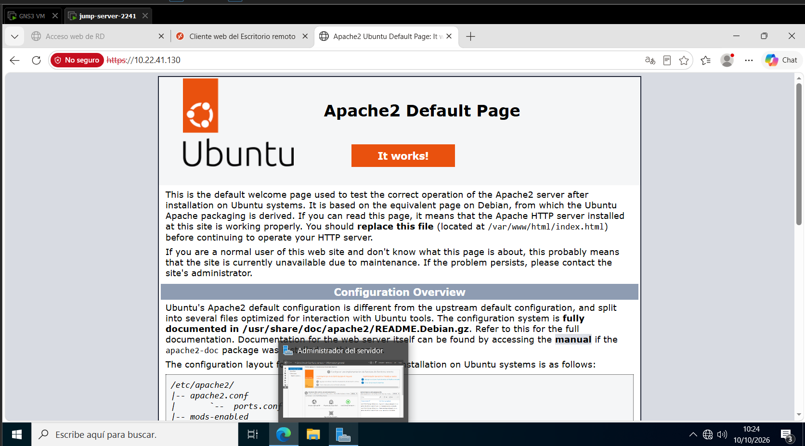

---

## 📜 Scripts de Prueba

En la carpeta [`scripts/`](scripts/) están los comandos que se utilizaron para realizar las pruebas. Cada archivo indica en su encabezado dónde se ejecuta, qué comprueba y qué resultado se espera.

| Script | Dónde se ejecuta | Qué comprueba | Captura |
| --- | --- | --- | --- |
| [`01-vpn-cliente.sh`](scripts/01-vpn-cliente.sh) | `vpn-usuario-2241-1` (cliente VPN) | La VPN levanta y solo llega al Jump Server | `35`, `36` |
| [`02-jump-a-web.ps1`](scripts/02-jump-a-web.ps1) | PowerShell del Jump Server | El Jump Server solo llega a HTTPS, RDP y SSH del Web Server | `23` |
| [`03-usuarios-vlan10.sh`](scripts/03-usuarios-vlan10.sh) | `usuario-priv-2241` y `usuario-sinpriv-2241` | DHCP, acceso al Jump por HTTPS y SSH bloqueado | `33`, `34` |
| [`04-webserver-servicios.sh`](scripts/04-webserver-servicios.sh) | Web Server (Ubuntu) | HTTPS, SSH y RDP activos | `20` |
| [`05-jump-dominio.ps1`](scripts/05-jump-dominio.ps1) | PowerShell del Jump Server | Dominio, usuarios y grupos | `22` |
| [`06-jump-red.ps1`](scripts/06-jump-red.ps1) | PowerShell del Jump Server | IP, gateway y rutas de retorno | `21` |
| [`07-comandos-show-cisco.txt`](scripts/07-comandos-show-cisco.txt) | ISP, router Cisco y switches | Interfaces, rutas, NAT, VLAN y trunk | `02` a `06` |

Las pruebas que se hacen por interfaz gráfica (los logs de **Forward Traffic** del FortiGate y el RD Web Client) están documentadas en la sección de validación y en [`scripts/README.md`](scripts/README.md).

---

## 📁 Estructura del Repositorio

```
README.md
image/
├── 01-topologia.png
├── 02-isp.png
├── 03-router-cisco.png
├── 04-show-vlan-brief.png
├── 05-trunk-usuario.png
├── 06-switch-usuario-vpn.png
├── 07-interfaces-fortigate.png
├── 08-vlan10-dhcp.png
├── 09-rutas-estaticas.png
├── 10-objetos-direcciones.png
├── 11-politicas-firewall.png
├── 12-politica-vpn-jump.png
├── 13-politica-jump-to-web.png
├── 14-politicas-deny-ssh.png
├── 15-configuracion-vpn.png
├── 16-grupo-vpn.png
├── 17-usuario-vpn.png
├── 18-logs-deny-sinpriv.png
├── 20-webserver-servicios.png
├── 21-jump-red.png
├── 22-jump-dominio.png
├── 23-jump-a-web.png
├── 24-rds-coleccion.png
├── 25-remoteapp-programas.png
├── 26-asignacion-putty.png
├── 27-rds-implementacion.png
├── 28-rdweb-priv.png
├── 29-rdweb-sinpriv.png
├── 30-putty-web.png
├── 31-rdp-web.png
├── 32-https-web.png
├── 33-usuario-priv.png
├── 34-usuario-sinpriv.png
├── 35-vpn-conectada.png
└── 36-vpn-pruebas.png

running-configs/
├── isp.txt
├── router-cisco.txt
├── switch-2241-1.txt
├── switch-2241-2.txt
└── FortiGate.conf

scripts/
├── README.md
├── 01-vpn-cliente.sh
├── 02-jump-a-web.ps1
├── 03-usuarios-vlan10.sh
├── 04-webserver-servicios.sh
├── 05-jump-dominio.ps1
├── 06-jump-red.ps1
└── 07-comandos-show-cisco.txt
```
